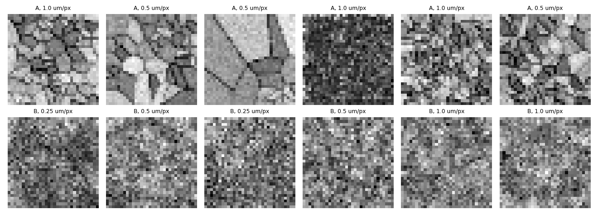
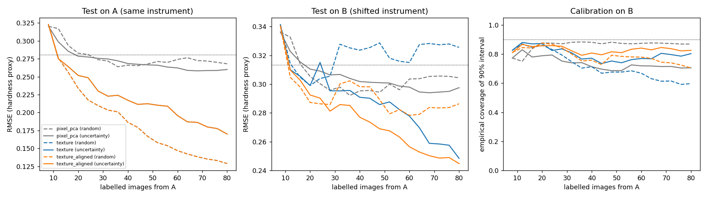

# Representation & Active Learning for Micrographs under Instrument Shift

A small, fully reproducible demonstrator of three questions from scientific-imaging ML:

1. **Representation:** which image representation lets a model predict a physical property from a micrograph?
2. **Robustness:** does that representation survive a change of instrument (noise, blur, contrast)?
3. **Active learning:** if labels are expensive, does choosing images by model uncertainty beat random labelling, and is the uncertainty calibrated?

It runs on a laptop CPU in about one minute and needs no downloads.



## Setup

**Data.** `src/data.py` generates synthetic grain microstructures (Voronoi tessellations) at three magnifications (0.25, 0.5 and 1.0 µm/px). The target property is a Hall–Petch-style hardness proxy, `H = 1 + 2/sqrt(d)`, where `d` is the mean grain size in µm. Images are rendered through two simulated instruments:

- **A (source):** sharp, clean, high boundary contrast. All labels come from A.
- **B (target):** noisier, blurrier, lower contrast. Never labelled; used only for testing (plus 600 unlabelled images).

The magnification is treated as known metadata, as it is in real microscopes.

**Representations** (`src/representations.py`):

| Name | Description |
| --- | --- |
| `pixel_pca` | 16-component PCA on raw pixels (baseline) |
| `texture` | Multi-scale texture features (gradient energy + local binary patterns at 3 smoothing scales), standardised with source statistics |
| `texture_aligned` | Same features, but each instrument is standardised with its own statistics from **unlabelled** images, a simple unsupervised domain alignment |

**Active learning** (`src/active_learning.py`): a Gaussian-process regressor starts from 8 random labels and adds 4 per round up to 80, chosen either at random or by highest predictive standard deviation. We report RMSE and the empirical coverage of the GP's 90% predictive interval.

## Run

```bash
pip install -r requirements.txt
python run_experiment.py
```

Outputs go to `results/`: `learning_curves.png`, `example_micrographs.png`, `results.json`, `summary.txt`.

## Results (80 labels, mean ± std over 5 seeds)

Predict-the-mean RMSE is 0.281 on A and 0.313 on B.

| Representation | Strategy | RMSE on A | RMSE on B | 90% coverage on B |
| --- | --- | --- | --- | --- |
| pixel_pca | random | 0.268 ± 0.017 | 0.304 ± 0.020 | 0.87 |
| pixel_pca | uncertainty | 0.260 ± 0.024 | 0.298 ± 0.035 | 0.71 |
| texture | random | 0.129 ± 0.006 | 0.326 ± 0.058 | 0.60 |
| texture | uncertainty | 0.170 ± 0.010 | 0.248 ± 0.012 | 0.80 |
| texture_aligned | random | 0.129 ± 0.006 | 0.286 ± 0.032 | 0.70 |
| texture_aligned | uncertainty | 0.170 ± 0.010 | **0.245 ± 0.008** | 0.83 |



## What the results show

- **Representation matters most.** Raw-pixel PCA barely beats predicting the mean. Multi-scale texture features cut in-domain error by about half (0.129 vs 0.268).
- **Good in-domain features can fail under instrument shift.** With source-only standardisation and random labels, texture features do *worse* than the mean on B (0.326), and their uncertainty is badly over-confident (60% coverage for a nominal 90% interval).
- **Unsupervised alignment helps.** Standardising each instrument with its own unlabelled statistics reduces B error with random labels (0.326 → 0.286) and improves calibration.
- **Uncertainty sampling is a trade-off, not a free win.** It makes the model clearly more robust on B (0.245 vs 0.286) but is *worse* than random in-domain (0.170 vs 0.129), because it spends labels on unusual, high-variance images rather than covering the typical distribution.
- **Calibration under shift is still unsolved here.** Even the best setting covers 83%, not 90%, on B.

## Limitations and next steps

- The data are synthetic and 32×32 pixels. Real SEM/TEM/EBSD images have richer contrast mechanisms and artefacts.
- Features are hand-crafted. A natural next step is self-supervised representation learning (e.g. contrastive or masked-image pre-training) with augmentations designed to mimic instrument differences, compared against these baselines.
- Acquisition functions that balance uncertainty with representativeness (e.g. density-weighted or batch-diverse sampling) should address the in-domain penalty of pure uncertainty sampling.
- Conformal prediction could be used to restore valid coverage under shift.

## Structure

```
src/data.py                 synthetic micrograph generator and instruments
src/representations.py      pixel PCA, texture, texture + alignment
src/active_learning.py      GP surrogate, random vs uncertainty acquisition
run_experiment.py           full pipeline, figures and summary
results/                    generated outputs
```

Author: Sahar Mirzabaki · [GitHub](https://github.com/SaharMb90) · [Portfolio](https://portfolio2-phi-khaki.vercel.app/)
